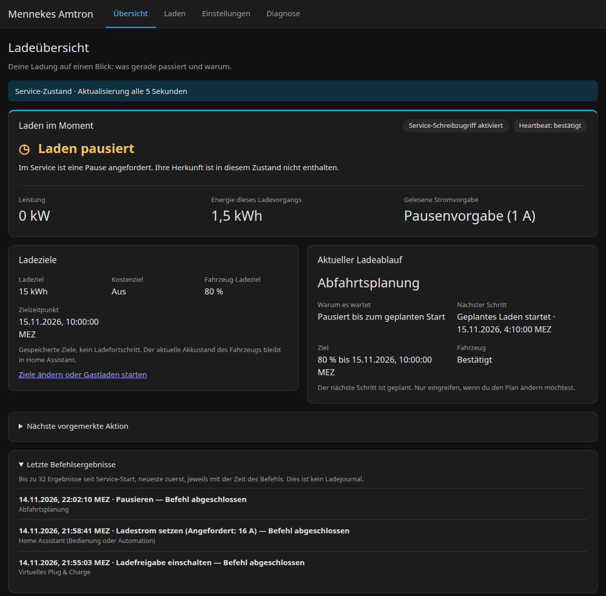
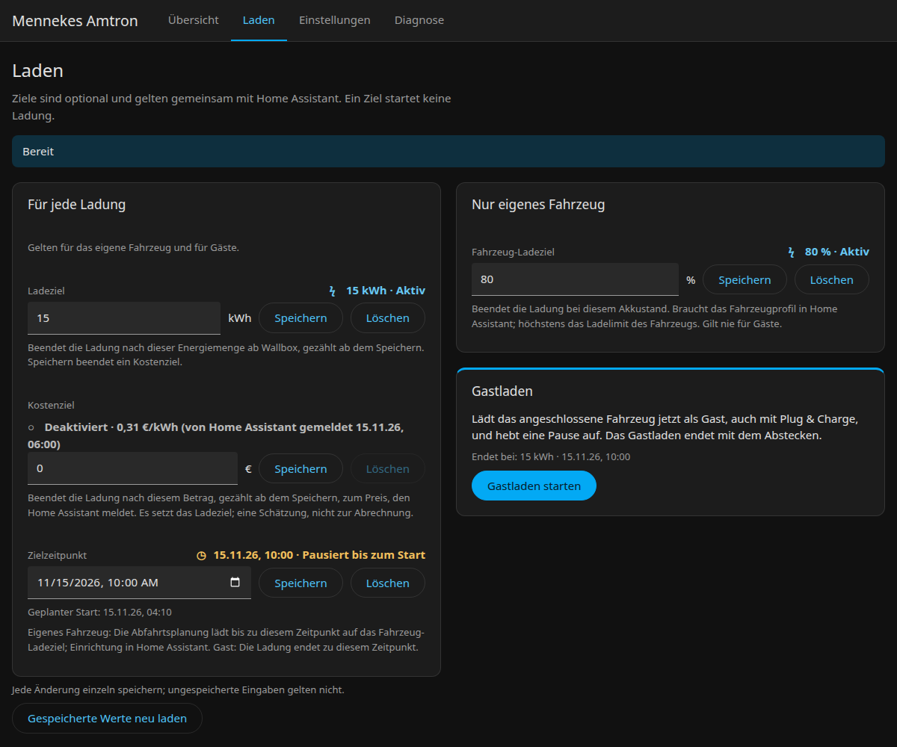

# Use the app's web interface

[Guide home](README.md) · [Install the app](modbus-service.md) · [HA dashboard](app-from-home-assistant.md) · [Help](troubleshooting.md)

In Home Assistant, open **Settings → Apps → Mennekes Amtron Modbus Service →
Open Web UI**. The interface requires an administrator account. It is provided
by the service app; a direct integration connection has no app web interface.

| You want to… | Page |
|---|---|
| See whether the car is charging and why it waits | **Overview** |
| Check what changed the current or stopped charging | **Overview → Recent command results** |
| Set or clear the energy, cost, time or vehicle charge target, or start a guest | **Charging** |
| Set up USB or LAN | **Settings → Connection** |
| Change the current cap, polling or waiting interval | **Settings → Runtime** |
| Investigate a problem | **Diagnostics → Registers** or **Log** |

Configure vehicle profiles, recognition, percentage sources and intelligent
departure planning in **Home Assistant**. Once handed over, the app can execute
a vehicle plan while HA is offline. The web interface needs no separate saved
charging order.

## Overview

The overview opens first. It refreshes every five seconds while the page is
visible and shows:

- **Current charging plan**: which of the app's controllers decides right now (a
  guest charge, departure plan or direct control), why
  the car does not charge yet, the next step with its time, the target and
  whether Home Assistant confirmed the car. Home Assistant shows the same
  summary as [Charging wait reason](entities.md#charging-wait-reason) and its
  attributes.
- the **observed charging state** read from the wallbox, and why the app holds
  a pause or a stop, for example a reached target or a switched-off release
- power, session energy and the current limit read back from the wallbox;
  **0 A means unlimited**, not paused
- whether writes are enabled and whether the heartbeat is confirmed
- the **next queued action** and its earliest time; queued does not mean done
- **Charge targets**: the saved energy, cost and vehicle charge target and the
  target time, with one link to the page that changes them; they are targets,
  not progress
- up to 32 recent command results since the app started, newest first

If the app cannot be reached, the page hides old values instead of showing them
as current. The overview never changes charging.

**Recent command results** is collapsed by default. Open it to see when a command
finished, what it requested, which function triggered it and its outcome. A failed
or replaced command includes the reason. For example, a Plug & Charge release is
distinct from a current change sent through Home Assistant. A Home Assistant
source can be a control or an automation; it does not identify a person.
The requested amperes are a setting, not the current actually drawn by the car.
Check the observed charging state and power above for the physical result.

The time beside each result is the original command-event time. For a longer
timeline together with plug-in, charging and fault changes, use **Home Assistant
Activity → Activity**. The HA timeline is dated when HA received the event;
the `occurred_at` attribute keeps the original time.
[Activity details and repeated commands](troubleshooting.md#understand-the-activity-timeline).

The overview also gives a suggested action for common waiting states. Briefly
differing readings show **Checking status**; missing or persistently conflicting
readings are explained separately. [Status messages](troubleshooting.md#charging-status-is-being-checked)
describe when to investigate. These displays do not override a pause or authorize
a vehicle.

*German interface with simulated example values. The app also supports English,
French, Italian and Dutch.*

## Charge targets

Open **Charging**. The page names every target as Home Assistant does and
sorts them by whom they apply to:

- **For every charge** (your own car and guests): the **energy target** in kWh,
  the **cost target** in Home Assistant's currency and the **target time**.
- **Own car only**: the **vehicle charge target** in percent. It never applies
  to a guest.
- **Guest charging**: the start button, and below it what ends a guest charge
  with the values saved right now.

Every target has its own **Save** and **Clear**, and shows its saved value and
state beside its name. Unsaved input is not used; a guest start waits until it
is saved or reloaded. The same values appear in Home Assistant. A target never
starts a charge.

The **cost target** needs charging costs configured in Home Assistant, which
reports the price and its currency to the app. It sets the energy target: saving an energy
target by hand ends it, and clearing it clears both. Without an amount the page
names the price and when Home Assistant last reported it.

The **vehicle charge target** is judged on the car's charge level only while
the car reported it within the last 15 minutes. A report of the car's charge
limit, or a poll, does not make an older level current; until the car reports
its level again, the target stays active and does not stop the charge.
Saving one target leaves another input that was changed elsewhere marked as
changed: reload and check it before saving it.

*German interface with simulated example values.*

## Target time

The target time means two things, and the page says which one applies. For your
own car it is the departure: the plan charges to the vehicle charge target by
then; it is set up in Home Assistant and uses the charge level and battery
capacity. See [planning](departure-planning.md). For a guest it is the end of
the charge: guest charging does not wait for a planned start.

## Guest charging

Press **Start guest charging** to start now. It lifts a manual pause and grants
permission for this connection, including when virtual Plug & Charge is enabled.
The energy target, the cost target and the target time end the charge,
whichever comes first; the card lists them, or says that none is set. The
vehicle charge target stays saved, shows **does not apply to the guest**
meanwhile, and is not used. Locks, faults and electrical limits still apply.
For example, set **10 kWh** and **07:30 tomorrow**, save both, then start.

The same button changes to **Pause guest charging** while active. Use it, the
ordinary HA pause switch, or unplug to stop; guest charging ends with the
unplug. See [charging details](app-from-home-assistant.md).

## Registers

**Registers**, a page below **Diagnostics**, lists every register the integration knows, with address, raw
words, decoded value, last successful read and last attempt. The **Quality**
column describes the reading, not the wallbox:

| Quality | Meaning |
|---|---|
| OK | Read successfully within its normal interval. A fault code can be OK when it was read correctly. |
| Degraded | The last value is older than expected, a later read failed or the value is unknown. |
| Error | No usable value, or the wallbox is not reachable. |
| Unknown, unsupported, write-only | Not read yet, not supported by this wallbox's firmware, or not readable. |

Filter, sort and **Freeze display** only affect the browser. The page adds no
Modbus traffic and no Recorder history. The serial number is hidden.

## Runtime settings

**Runtime** (German: **Betrieb**) shows each setting three times: **Effective**
(in use now), **Saved** and your proposed change. Select **Change preview**,
check the result and select **Confirm and save**.

| Setting | When it takes effect |
|---|---|
| Status interval, measurement interval | At the next polling cycle. |
| Service current cap | At once for new commands. A charge running above a lower cap is lowered after the next poll. |
| State-change interval | At once, also for a start or stop that already waits. |
| Phase-switch grace | For the next phase-switch wait; a wait that already runs keeps its length. |

None of them needs a restart, and the page never restarts the app. The app
lowers a charging current above its cap after the next poll, also after an app
restart with a lower cap. A queued command, a guest session and Home Assistant's
departure plan use the new cap when they next set the current.

A value changed in the app's **Configuration** tab is only read at the next app
restart. Until then the page shows it as saved but not yet effective; **Change
preview** and **Confirm and save** apply it at once. A changed connection, read-only mode,
listen address or port always needs an app restart; the page lists them.

If someone changed the settings meanwhile, the page asks you to reload. If a
save could not be confirmed, the page blocks further saves until the app
restarts; check the **Configuration** tab to see what was saved.

## Connection

**Connection** (German: **Verbindung**) holds the USB or LAN connection and the
optional LAN-adapter setup; see [first setup](modbus-service.md#3-configure-and-start-read-only)
and [LAN adapters](lan-adapters.md#service-app). Changes take effect after an
app restart.

## Log

**Diagnostics → Log** (German: **Diagnose → Protokoll**) shows the app's own Modbus reads, writes and
heartbeats one line each, as they happen. It starts when you open the page and
follows the newest line; scroll up to read on undisturbed. **Pause** holds the
view while new lines are still collected, **Filter** narrows it to a register
or result, **Download** saves the lines shown as a text file.

The recording lives in memory only, adds no bus traffic and hides serial
numbers and login traffic. It ends by itself within ten minutes after the page
is closed. See [troubleshooting](troubleshooting.md#watch-app-modbus-communication-live).

## Limits

- The pages show what the app knows. Home Assistant supplies vehicle data and departure choices. The overview
  shows the app’s active controller and target; edit the vehicle profile and
  next departure in HA.
- An HA Core restart leaves the service running. An app restart restores guest permission
  and limits only for the proven same plug-in, preserving a deliberate pause.
  Without that proof it stops and requires a new guest start. [Restart details](user-guide.md#guest-charging).
- A stop you request is shown as requested until the wallbox confirms it. Check
  the overview and its command results.
- The browser never repeats a start command by itself. If a reply is lost, reload the
  page and check the current state before trying again.

For the HTTP interface behind these pages, see the
[service reference](service-reference.md#guest-charging-api).
