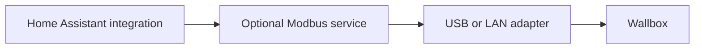

# Install and connect your wallbox

[Documentation](README.md) › Installation

Install the Home Assistant integration, then choose who connects to the
wallbox: the optional service app or Home Assistant itself. Normal setup on
Home Assistant OS uses the UI and needs no YAML or command line.

Already installed? Keep your existing entry and go to [Updates](#updates) or
[move the existing wallbox to the service](modbus-service.md#move-an-existing-wallbox).

## Before you start

- Home Assistant **2026.9.0 or newer** and a [supported wallbox](compatibility.md).
- A qualified electrician has prepared Modbus satellite mode, RS-485 wiring and
  the wallbox's fallback. Follow the [hardware guide](hardware.md).
- A USB RS-485 adapter or [LAN-to-RS-485 adapter](network-gateway.md).
- One software owner for that bus. The service, a direct HA connection and
  another energy manager must not use it simultaneously; read-only still sends
  requests.

Keep the vehicle disconnected during the first control setup.

## 1. Choose your connection

| | Service app — recommended, optional | Direct USB or LAN |
|---|---|---|
| Install | Integration plus service app | Integration only |
| Who uses the adapter? | Service app | Home Assistant |
| During an HA Core restart | Heartbeat and last charging state continue | Heartbeat is interrupted; wallbox fallback applies |
| Where are writes enabled? | App **Configuration → Read-only** off | Integration **Configure → Wallbox → Control mode: Modbus master** |
| Charging orders while HA is offline | [Charging jobs and guest charging](app-guide.md#charging-jobs) in the app | Not available |

Both support USB and LAN. A LAN adapter needs no local USB device. On HA
Container, the service can run as a [separate container](service-standalone.md).
The service keeps a deliberate pause as well as a running charge while HA is
offline; HA automations and vehicle-based planning still need HA to run.
An app/host restart or USB/LAN failure can interrupt either setup's heartbeat.

Without the service, Home Assistant connects directly to that adapter.

## 2. Install the integration

### Home Assistant 2026.11 and newer

Open **Settings → Marketplace** and install **Mennekes Amtron RTU** by
**memphi2**. Choose the stable release unless you deliberately want a beta.
Accept the community-content notice and follow any restart request.
A first Marketplace installation can load without a Core restart; replacing
already loaded code requires one.

### Home Assistant 2026.9 and 2026.10

Open **HACS**, find **Mennekes Amtron RTU** by **memphi2**, download the stable
release and restart Home Assistant. If needed, add
`https://github.com/memphi2/ha-mennekes-amtron` in **HACS → ⋮ → Custom
repositories**, category **Integration**.

To update an existing installation, follow [Updates](#updates).

## 3. Connect the wallbox

| Your choice | Next step |
|---|---|
| **Service app on HA OS** | [Install and configure the app](modbus-service.md#install-on-home-assistant-os), leave it read-only and confirm its discovery in HA. URL and token are supplied automatically. |
| **Standalone service** | [Start the service](service-standalone.md), then enter its service URL and token when adding the integration. |
| **Direct USB** | [Add a direct serial connection](quickstart.md#direct-serial-connection) and select the adapter. |
| **Direct LAN** | [Add a direct LAN connection](quickstart.md#direct-lan-adapter-connection) with protocol, adapter IP/hostname, TCP port and wallbox address. |

A **Service URL** points to this project's HTTP service. An adapter's **IP and
TCP port** point to the LAN-to-RS-485 hardware. They are different fields for
different connections. On HA OS, you normally type neither a service URL nor a
token for the app.

The app's **Open Web UI → Connection** provides guided connection setup on
**Supervisor 2026.10.4+**. Native **Configuration** remains available for manual
setup. See [the app's web pages](app-guide.md).

## 4. Check readings and try a charge

Compare the readings with the wallbox while still read-only. Choose an
appropriate current cap, then enable writes in the single place shown in the
connection table. Follow [First charge](quickstart.md#7-first-charge) to check
current control, pause and resume. Verify **Connection quality** (its
`heartbeat` attribute should read `ok`) and resolve connection repairs before
adding automation.

Basic charging is now ready. [Optional functions](features.md) covers vehicle
sources, one or several cars, targets, calendars, costs and losses. None is
required just to use the wallbox.

## Updates

Before version 1.0, beta updates may deliberately change configuration, stored
state and the service API without migration. Read the release notes first.
After an incompatible update, reconfigure the affected profiles or planning
options and verify Plug & Charge, pause, release, charging target and departure
before use. An incompatible saved app state is preserved and charging control is blocked.
Open **Settings → System → Repairs** in HA to acknowledge safe defaults: pause
on, charging release off, resume current 6 A and no targets. This does not start
charging. Reconfigure the desired policies before explicitly enabling release
and resuming. In read-only mode the app cannot stop a physical charge.
This does not change the supported wallbox families or minimum Home Assistant
version. The current integration requires service **0.9.0b4 or newer**, API 2;
app and integration versions do not otherwise have to match.

1. Back up HA and read the release notes, especially the changes marked
   **Breaking**. Keep the existing integration entry.
2. In service mode, update the app or standalone service first and wait until it
   has started. Its restart briefly interrupts the heartbeat.
3. Update the integration through **Settings → Updates**, the Marketplace or
   HACS, then complete the requested HA Core restart.
4. Check current readings, heartbeat, pause/release and the intended current.

Use **Check for updates** in the app store if an offered app update is missing.
Moving between stable and beta app catalogs creates a separate app and requires
[the channel handover](modbus-service.md#updates). Moving from HACS to Marketplace
does not require adding the wallbox again. For changed blueprints,
[update the existing automation](blueprints.md#updating-existing-blueprint-automations).

## Change settings later

| Setting | Where to change it |
|---|---|
| Direct USB/LAN connection | Integration entry **Reconfigure** |
| App USB/LAN connection | App **Open Web UI → Connection**, or native Configuration where needed |
| App polling intervals | App **Open Web UI → Runtime**; applies without restart |
| App current cap and charging waits | App **Open Web UI → Runtime** or **Configuration**, then restart the app |
| App write permission | App **Configuration**, then save and restart the app |
| Vehicles and charging costs | Integration **Configure**, in the relevant section |
| Wallbox options of a direct connection | Integration **Configure → Wallbox**; with the app this page only shows the app's values |

Apart from the polling intervals, app settings take effect after an app
restart; HA then receives the new status without an additional Core restart. Use [the settings map](user-guide.md#configuration-and-options)
for the full list. Keep device/entity IDs when changing connection; do not
remove and re-add the wallbox.

## Removal

1. Stop charging and disable automations that control the wallbox. Check its
   fallback before stopping the heartbeat.
2. Remove the intended entry under **Settings → Devices & services**. A direct
   entry releases the adapter. A service entry only disconnects HA: **the app
   keeps running** until you stop it separately.
3. Uninstall the integration from the Marketplace or HACS once no remaining
   entry uses it, then follow any restart request.

Removal does not reset wallbox settings or delete Recorder history and
blueprints. Update dashboards and automations that used the removed entities.
Stop the app separately before giving the adapter to another bus owner.

---

[Everyday use](user-guide.md) · [Troubleshooting](troubleshooting.md) · [Keep history manageable](recorder.md)
